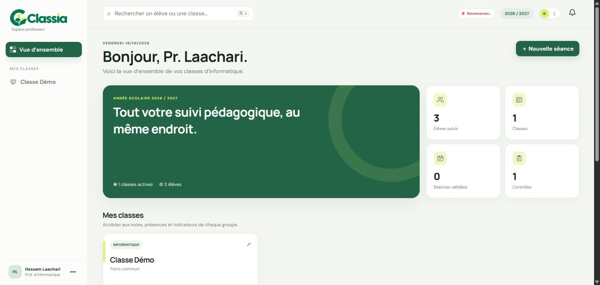
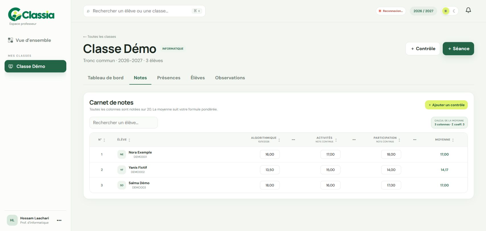

# Classia

Classia est une application web de suivi pédagogique pensée pour les enseignants. Elle centralise les notes, les présences, les séances, les observations et quelques indicateurs de progression dans une interface responsive.

> Le dépôt public ne contient aucune donnée d’élève. Les captures ci-dessous utilisent uniquement des personnes et identifiants fictifs.



## Fonctionnalités

- Carnet de notes avec contrôles dynamiques, coefficients et moyenne pondérée.
- Suivi des séances, présences, retards et heures d’absence.
- Observations générales ou associées à plusieurs élèves.
- Tableaux de bord, histogramme, médiane, taux de réussite et dispersion.
- Gestion des élèves actifs et anciens, tri, recherche et numéros d’ordre.
- Thèmes clair et sombre, navigation responsive et sauvegarde hors ligne.
- Synchronisation avec PostgreSQL ou MySQL/MariaDB.



## Prérequis

- Node.js 20 ou version ultérieure.
- PostgreSQL 14+ ou MySQL/MariaDB 8+.

## Installation locale

```powershell
git clone https://github.com/HLaachari/prof_eval_project.git
cd prof_eval_project
npm install
Copy-Item .env.example .env
npm start
```

Renseignez la connexion à la base dans `.env`, puis ouvrez `http://localhost:4173`. Le moteur est détecté automatiquement à partir de `DATABASE_URL`, ou peut être configuré avec les variables `DB_*` décrites dans `.env.example`.

Vérifiez la connexion avec :

```powershell
Invoke-RestMethod http://localhost:4173/api/health
```

En production, définissez aussi `APP_USERNAME` et un `APP_PASSWORD` long et aléatoire. Ces variables et la chaîne de connexion restent côté serveur.

## Commandes utiles

```powershell
npm start          # démarre l’application
npm test           # exécute les tests automatisés
npm run check      # vérifie la syntaxe JavaScript
npm run migrate:database
```

## Migration PostgreSQL vers MySQL

Définissez `SOURCE_DATABASE_URL` et les variables `TARGET_DB_*`, puis lancez `npm run migrate:database`. La cible doit être vide par défaut. Consultez le script `tools/migrate-database.mjs` avant d’activer les options de remplacement d’une base existante.

## Confidentialité et sécurité

Les listes de classe, codes Massar, dates de naissance, notes, présences et observations sont des données personnelles. Ne les commitez jamais. Le fichier `.env`, les réglages IDE, les états locaux et les archives générées sont ignorés par Git. Utilisez exclusivement des données fictives dans les tests, tickets et captures.

Si une donnée réelle a déjà été publiée, la supprimer du dernier commit ne suffit pas : réécrivez l’historique Git concerné et révoquez immédiatement tout secret exposé.

## Feuille de route

- Ajouter un import de liste de classe guidé et validé.
- Renforcer la couverture des tests métier et des tests d’API.
- Ajouter des rôles et une journalisation des modifications.
- Améliorer l’accessibilité clavier et les exports imprimables.
- Documenter les stratégies de sauvegarde et de restauration.

## Contribution

Les contributions sont bienvenues. Lisez [CONTRIBUTING.md](CONTRIBUTING.md), travaillez avec des données fictives et exécutez `npm test` puis `npm run check` avant d’ouvrir une pull request.

## Licence

Distribué sous licence [MIT](LICENSE).
